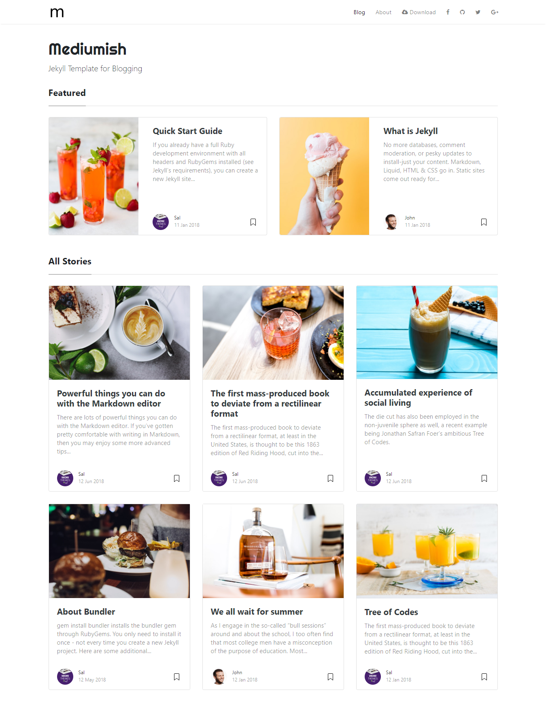

# thatvirtualboy.github.io

## Homepage YouTube Shorts

Jekyll renders the three newest public Shorts from `_data/youtube_shorts.json`. The
**Refresh YouTube Shorts** workflow reads the channel's Shorts-only Atom feed at
13 and 43 minutes past each hour. It orders videos by publication time and keeps
the previous selection if the feed is unavailable, empty, or invalid.

For production, choose **Settings → Pages → Source → GitHub Actions** in the
repository. **Publish Jekyll site** builds pushes to `master` using Ruby 3.4 and
the plugins in `Gemfile.lock`, including the individual tag archives. It checks
the finished site against the 1 GB Pages limit before deploying.

The Shorts workflow needs permission to commit its data file to the default
branch and dispatch **Publish Jekyll site**. If a deployment is missed, the
next check compares the public search index with the cached Shorts and retries.
GitHub can pause scheduled workflows after 60 days of inactivity in a public
repository. Re-enable it from Actions and choose **Run workflow** to catch up.

Run this command in the repository to refresh the data for the local preview.

```sh
curl -fsSL 'https://www.youtube.com/feeds/videos.xml?playlist_id=UUSHZZp0nggS2twDjqkffD3QqA' | python3 .github/scripts/update_shorts.py
```

## Mediumish theme

[Live Demo](https://wowthemesnet.github.io/mediumish-theme-jekyll/) &nbsp; | &nbsp; [Download](https://github.com/wowthemesnet/mediumish-theme-jekyll/archive/master.zip) &nbsp; | &nbsp; [Documentation](https://bootstrapstarter.com/bootstrap-templates/template-mediumish-bootstrap-jekyll/) &nbsp; | &nbsp; [Buy me a coffee](https://www.wowthemes.net/donate/)




### Copyright

Copyright (C) 2019 Sal, https://www.wowthemes.net

**Mediumish for Jekyll** is designed and developed by [Sal](https://www.wowthemes.net) and it is *free* under MIT license. 

<a href="https://www.wowthemes.net/donate/" target="_blank"></a>

### Contribute

1. [Fork the repo](https://github.com/wowthemesnet/mediumish-theme-jekyll).
2. Clone a copy of your fork on your local
3. Create a branch off of master and give it a meaningful name (e.g. my-new-mediumish-feature).
4. Make necessary changes, commit, push and open a pull request on GitHub.

Thank you!
