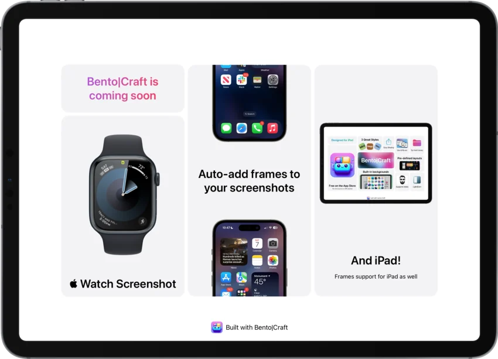
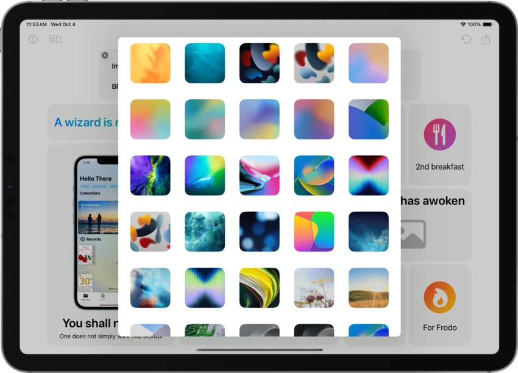
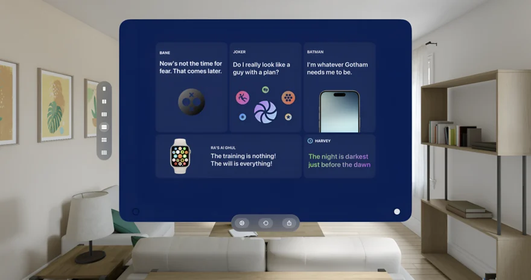

<section class="product-section">
  <h2>Build your layout</h2>
  

    
<h3>Start with a template</h3>
Choose a layout from Micro to Max, then drop in your copy and screenshots.

    
<h3>Make room on Canvas</h3>
Arrange boxes on the grid. Add text, symbols, and images, then choose a background that brings the pieces together.

    
<h3>Export your bento</h3>
Save the finished graphic as PNG, JPEG, or PDF for a launch post, presentation, or press kit.

  

</section>
<section class="product-panel" id="watch">
  
<h2>Watch a bento come together.</h2>
Follow a design from its first blocks to a finished graphic in this workspace walkthrough.

  <iframe src="https://www.youtube-nocookie.com/embed/4fYw1EQii9I" title="Bento|Craft workspace walkthrough" loading="lazy" allowfullscreen></iframe>
</section>
<section class="product-section">
  <h2>Inside the workspace</h2>
  

    <figure><figcaption>Put device frames around your screenshots.</figcaption></figure>
    <figure><figcaption>Choose a backdrop for the whole composition.</figcaption></figure>
    <figure><figcaption>Open the workspace on Apple Vision Pro.</figcaption></figure>
  

</section>
<section class="product-section product-support" id="privacy">
  <h2>Privacy &amp; support</h2>
Bento|Craft does not collect personally identifiable information.

  
<a href="mailto:support@raktech.app">Email support</a><a href="https://www.apple.com/legal/internet-services/itunes/dev/stdeula/">Apple Standard EULA</a>

</section>
