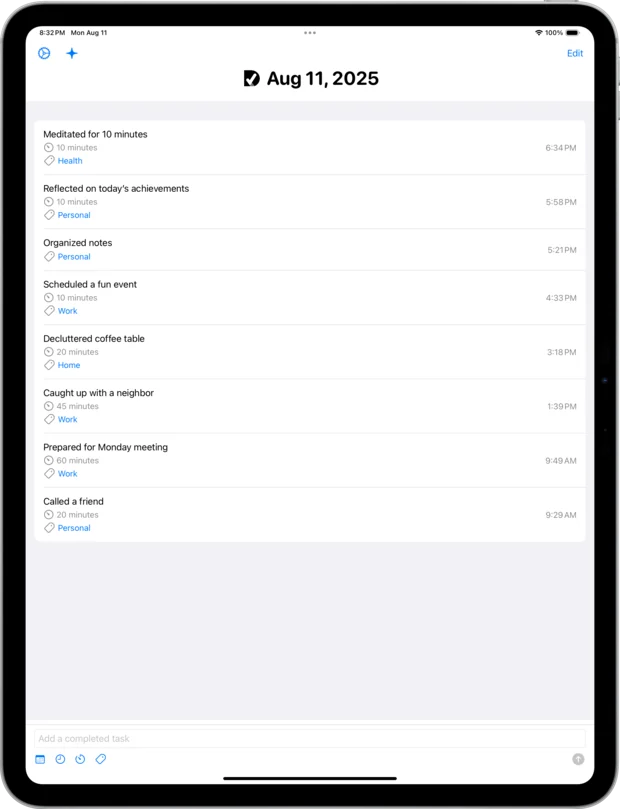
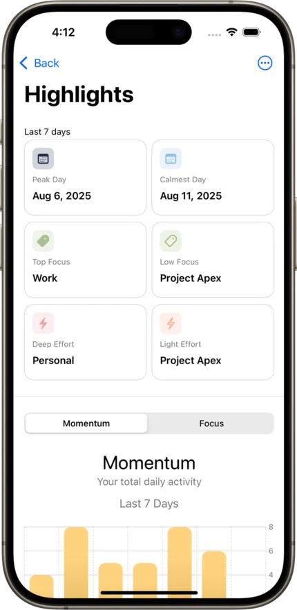
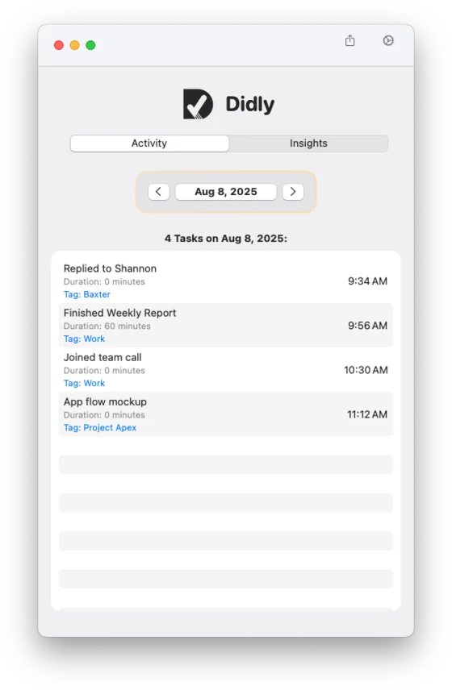

<section class="product-section" aria-labelledby="didly-value-title">
  <h2 id="didly-value-title">What went into your week?</h2>
  

    
<h3>Capture the small stuff</h3>
Log a finished project, a workout, or the errand that took all morning. Didly adds the timestamp. Add a tag or time spent when it’s useful.

    
<h3>Bring in your reminders</h3>
Pull completed Apple Reminders into your list, or use a Shortcut to record an accomplishment as part of your routine.

    
<h3>Write your weekly update</h3>
Choose a date range and export your entries as text, CSV, or JSON. The details are there when you need to report back.

  

</section>
<section class="product-section" aria-labelledby="didly-gallery-title">
  <h2 id="didly-gallery-title">Your done list in three views</h2>
  

    <figure><figcaption>Add work as you finish it.</figcaption></figure>
    <figure><figcaption>See how your effort adds up over the week.</figcaption></figure>
    <figure><figcaption>Find the details for your next weekly update.</figcaption></figure>
  

</section>
<section class="product-section product-split" aria-labelledby="didly-platform-title">
  
<h2 id="didly-platform-title">From quick entry to weekly review</h2>
See how to record a win on the go and review your history on a larger screen. iCloud keeps your entries together across devices.

  <iframe loading="lazy" src="https://www.youtube-nocookie.com/embed/rM3u5qAuv9s" title="Didly walkthrough" allowfullscreen></iframe>
</section>
<section class="product-section product-support" id="privacy" aria-labelledby="didly-privacy-title">
  <h2 id="didly-privacy-title">Privacy &amp; support</h2>
  
Personal data is stored on your device and synced through your iCloud account. No personal information is sent to the developer or third-party servers. Didly may collect anonymized general data, such as iOS or macOS versions, to help improve the app.

  
<a href="mailto:support@raktech.app">Email support</a><a href="https://telemetrydeck.com">TelemetryDeck</a><a id="terms" href="https://www.apple.com/legal/internet-services/itunes/dev/stdeula/">Apple Standard EULA</a>

</section>
