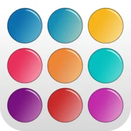
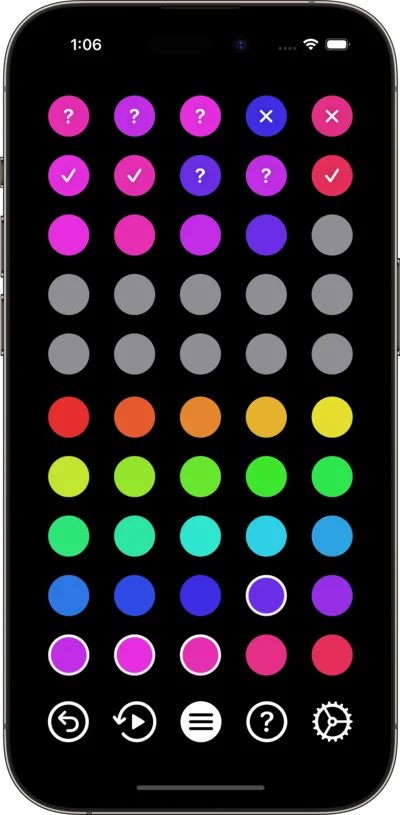
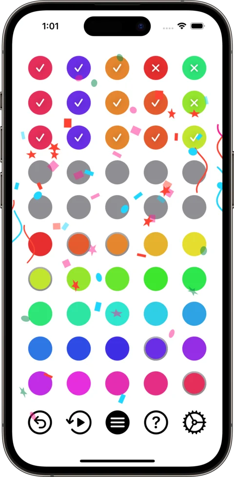
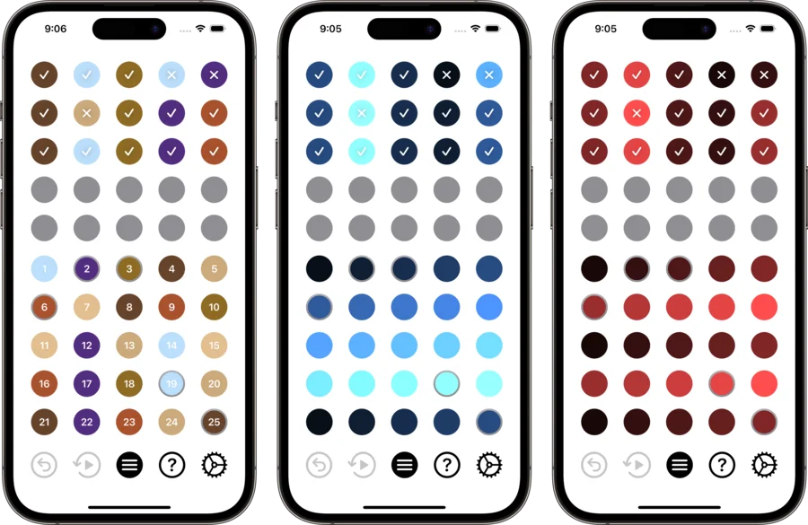

  <header class="echo-hero">
    

      
 Echodots

      <h1>Can you echo the pattern?</h1>
      
Five colors light up. You get five guesses to tap them back in order. Everyone plays the same puzzle each day.

      

        
        <a class="echo-text-link" href="#gameplay">How to play ↓</a>
      

    

    

      
      
    

  </header>

  <section class="echo-play" id="gameplay" aria-labelledby="echo-play-title">
    

      <h2 id="echo-play-title">How to play</h2>
      <ol class="echo-steps">
        <li><h3>Watch the sequence</h3>
Five dots light up in order. Play the clip to see what a round looks like.
</li>
        <li><h3>Tap it back</h3>
Pick the colors you remember, then double-tap the last dot to submit. You can undo a tap before you submit.
</li>
        <li><h3>Read the clues</h3>
A check means the right color in the right spot. A question mark means it belongs elsewhere. A cross rules that color out. Spend an Echo to watch the sequence again.
</li>
      </ol>
    

    <figure class="echo-demo">
      <video controls playsinline preload="none" width="576" height="508" poster="/assets/images/Echodots/site/sequence-poster.webp" aria-label="Example of a five-dot sequence playing on the game board">
        <source src="/assets/images/Echodots/site/sequence.mp4" type="video/mp4">
        <a href="/assets/images/Echodots/site/sequence.mp4">Watch the sample sequence</a>
      </video>
      <figcaption>A sample sequence from the game</figcaption>
    </figure>
  </section>

  

    <section id="accessibility">
      <h2>Play by color, number, or symbol.</h2>
      
Turn on sound cues, choose the high-contrast board, or give each dot a number or a symbol. These options come with the free game.

    </section>
    <section>
      <h2>Keep your streak.</h2>
      
Win on consecutive days to build a streak. Compare your best run on Game Center and share your result with friends while keeping the answer a surprise.

    </section>
  

  <section class="echo-plus" id="echodotsplus" aria-labelledby="echo-plus-title">
    

      <h2 id="echo-plus-title">Echodots+</h2>
      
The daily game is free and ad-free. A one-time purchase gives you more ways to play.

      <ul>
        <li>A weekly refill of seven Echos, up from three</li>
        <li>Sequence playback from 0.2× to 3× speed</li>
        <li>Nine extra board palettes and alternate app icons</li>
      </ul>
    

    
  </section>

  

    <section id="faq" aria-labelledby="echo-faq-title">
      <h2 id="echo-faq-title">Questions about the game</h2>
      

When does the daily puzzle change?

A new sequence arrives at midnight UTC. Enable Daily Alert in Settings for a reminder. If reminders stop, switch Daily Alert off and back on.

      

How do Echo refills work?

Play during the week to qualify for Sunday’s refill. It tops your balance up to three Echos, or seven with Echodots+. Weekly refills don’t stack. Extra Echos you buy are added to your balance.

      

Can I finish a game later?

Yes. Watching the sequence starts the game, and submitted guesses are saved. Choose Resume Game to continue. Replaying the sequence costs one Echo. Finish before the next daily puzzle to keep your streak alive.

      

What happens if I miss a day?

Missing a day or losing a puzzle resets your current streak. Your best streak stays on the Game Center leaderboard.

      

Can I slow down the sequence?

Yes. Echodots+ lets you choose a playback speed in Settings. Number and symbol overlays are available to everyone.

      

Do progress and purchases sync across devices?

Gameplay and your Echo balance sync through iCloud. Use the same iCloud account on both devices and relaunch the app if a game needs to catch up. You can restore Echodots+ on your other devices. Family Sharing is unavailable.

      

Does the game need an internet connection?

Yes. Echodots connects to its servers to load the daily sequence and check guesses.

      

What if my Home Screen widget is blank?

Try restarting your device to reload the widget.

      

How do I reset my game?

In Settings, open Support and choose Delete App Data. This deletes your gameplay history, including streaks and Echos.

    </section>
    <aside class="echo-resources">
      <section id="support"><h2>Support</h2>
Echodots is available on iPhone and iPad. The iPad version also runs on compatible Macs and Apple Vision Pro.
<a href="mailto:support@raktech.app">support@raktech.app</a></section>
      <section id="privacy"><h2>Privacy</h2>
Echodots collects anonymous gameplay statistics through TelemetryDeck, including streaks, palette choices, and game outcomes. It does not collect personally identifiable information.
</section>
      <section id="Extras"><h2>Press &amp; media</h2>
Echodots is a puzzle game by rakTech LLC. The kit includes device screenshots, the app icon, and gameplay footage.
<a href="/assets/images/Echodots/Presskit_Echodots.zip" download>Download the press kit ↓</a></section>
    </aside>
  

  <section class="echo-reviews" id="testimonials" aria-label="Player reviews">
    <blockquote>“It’s really fun! Like Wordle meets Simon!”<cite>From an Echodots player</cite></blockquote>
    

More player reviews

“It’s fun! Brain-games like these are great!”

“Echodots is addicting, I wish I could play more!”

    

Watch more Echodots videos

      

        <iframe src="https://www.youtube-nocookie.com/embed/UskNofm8q-s" title="Echodots video on YouTube" loading="lazy" allowfullscreen></iframe>
        <iframe src="https://www.youtube-nocookie.com/embed/8y088FjSsds" title="Second Echodots video on YouTube" loading="lazy" allowfullscreen></iframe>
      

    

  </section>

