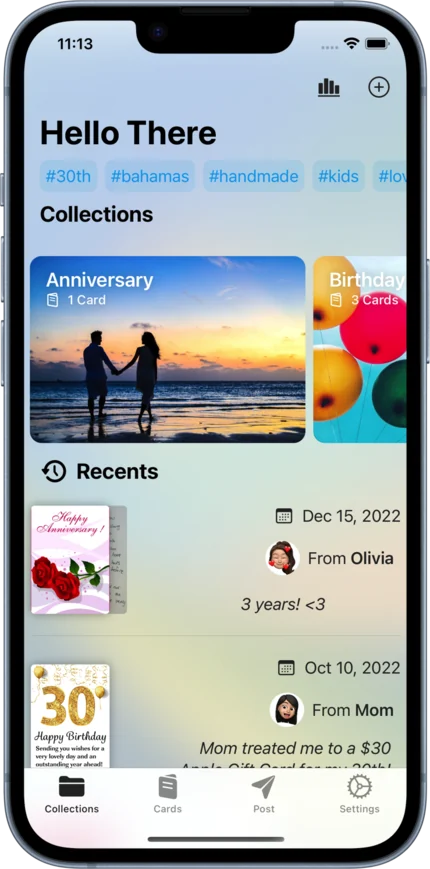
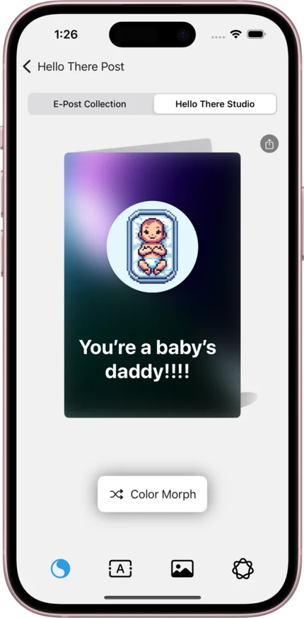
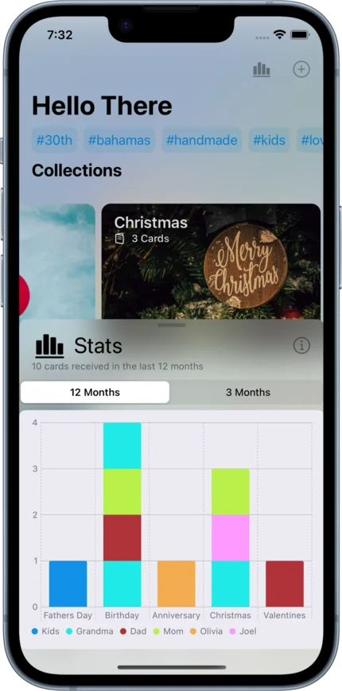

<section class="product-section">
  <h2>A shelf for your cards</h2>
  
Capture the cover and the message inside with automatic cropping. Sort cards into stacks by occasion, favorite a keepsake, or find it again by year.

  

    <figure><figcaption>Keep anniversaries, holidays, and birthdays in their own stacks.</figcaption></figure>
    <figure><figcaption>Design an e-card in E-Post Studio.</figcaption></figure>
    <figure><figcaption>Look back at a year of cards and the people who sent them.</figcaption></figure>
  

</section>
<section class="product-panel">
  
<h2>Send a card, too.</h2>
Share an e-card with E-Post, or order a handwritten card through Paper Post and have it sent in the mail.

  
<h3>E-Post Studio</h3>
Start with a card background, add your message, and make it yours. On supported devices, Apple Intelligence can help with an image or a few words.

</section>
<section class="product-section" id="plans">
  <h2>Free and Hello There+</h2>
  
Start with card scanning, stacks, widgets, sharing, stickers, and data export. Plus adds more ways to capture, organize, and protect your collection.

  <table aria-label="Hello There plan comparison"><thead><tr><th scope="col">Feature</th><th scope="col">Free</th><th scope="col">Hello There+</th></tr></thead><tbody>
    <tr><th scope="row">Photos per card</th><td>Up to 2</td><td>Up to 10</td></tr>
    <tr><th scope="row">E-Post</th><td>Selected designs</td><td>Full selection and E-Post Studio</td></tr>
    <tr><th scope="row">Sender profiles</th><td>Up to 10</td><td>Unlimited</td></tr>
    <tr><th scope="row">Hashtags, sound clips, and stats</th><td>—</td><td>Included</td></tr>
    <tr><th scope="row">iCloud sync and backup</th><td>—</td><td>Included</td></tr>
    <tr><th scope="row">Custom wallpaper, icons, and biometric lock</th><td>—</td><td>Included</td></tr>
  </tbody></table>
</section>
<section class="product-section">

Hello There in the press

  <blockquote>
"A neat solution to saving special greeting cards without keeping the physical clutter." - <strong>Michael Potuck</strong> // <a href="https://9to5mac.com/2023/03/27/hello-there-ios-greeting-card-organizer-update/">9to5Mac</a>
</blockquote>
  <blockquote>
"Hello There is well thought out and easy to use." - <strong>Brent Dirks</strong> // AppAdvice
</blockquote>
  <blockquote>
"An awesome way to be reminded of cards you've forgotten about." - <strong>Andrew O'Hara</strong> // <a href="https://fueled.com/blog/hello-there-helps-keep-cards-without-clutter/">Fueled</a>
</blockquote>

</section>
<section class="product-section product-support">
  <h2 id="privacy-policy">Privacy policy</h2>
    
Last updated October 27, 2026.

    
Your card library stays on your device and, when enabled, in your private iCloud account. Hello There does not sell your personal information.

    
Apple Intelligence features use Apple’s system frameworks to create content on supported devices. Hello There does not send those prompts or results to its own servers or to a third-party AI provider.

    
When you place a Paper Post order, the recipient and optional return address, your email address, and your message are sent securely to Hello There and the service providers needed to process payment, fulfill the order, and provide support. Apple Pay and Stripe handle payment details; Hello There does not receive your full card number.

    
Paper Post order information is retained only as long as reasonably needed for fulfillment, support, fraud prevention, and legal obligations. To ask a privacy question or request deletion of information associated with an order, email <a href="mailto:support@raktech.app">support@raktech.app</a>.

    <h3>Ads and analytics</h3>
    
Hello There does not use third-party product analytics. The free version may show non-personalized ads after any required privacy choices have been completed. Ad providers may process limited device, advertising, diagnostic, and approximate-location information to deliver and measure those ads.

  
<a href="mailto:support@raktech.app">Email support</a><a href="https://www.apple.com/legal/internet-services/itunes/dev/stdeula/">Apple Standard EULA</a>

</section>
