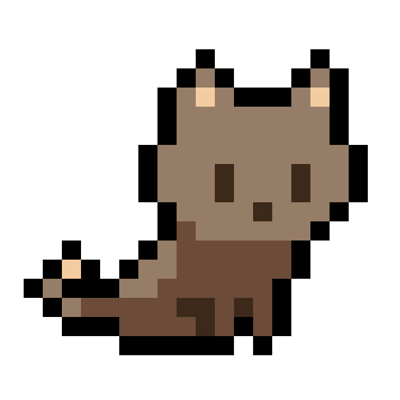
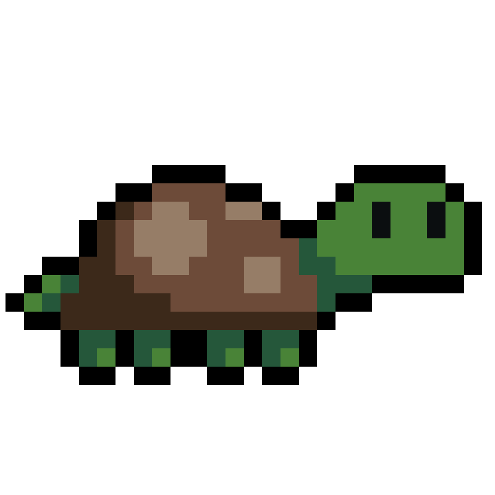
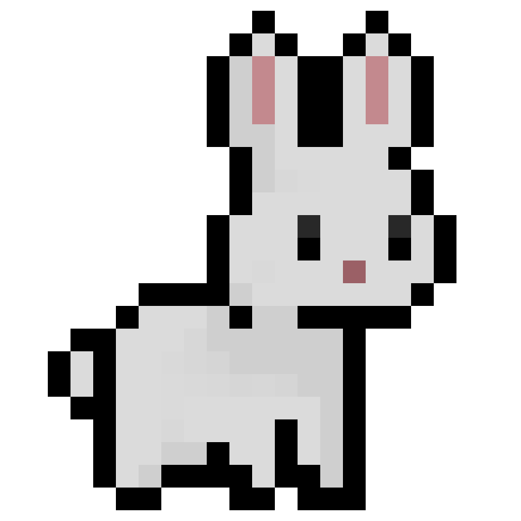

<section class="product-section" id="pals">
  <h2>Meet the pals</h2>
  
Start with Mocha. The coins you earn together can unlock more companions, backgrounds, and weather scenes.

  

    <figure><figcaption><strong>Mocha</strong>Always chasing sunbeams.</figcaption></figure>
    <figure><figcaption><strong>Sheldon</strong>Happy to take it slow.</figcaption></figure>
    <figure><figcaption><strong>Clover</strong>Always up for a hop.</figcaption></figure>
  

</section>
<section class="product-panel">
  
<h2>Breakfast, a walk, then a little playtime.</h2>
Check in when a care timer finishes and earn coins together. Haptics and optional reminders can give you a nudge when your pal is ready for company.

  <figure><video controls playsinline preload="none" width="480" height="480" poster="/assets/studio/apps/pixelpaws/care.webp" aria-label="Pixel Paws care and coin rewards on Apple Watch"><source src="/assets/studio/apps/pixelpaws/care.mp4" type="video/mp4"></video><figcaption>Check on Mocha, collect a daily reward, and browse new backgrounds.</figcaption></figure>
</section>
<section class="product-section product-support">
  
<h2>Made for family wrists</h2>
I made Pixel Paws because my kids wanted pets to care for on their Apple Watches. The game plays offline, coins are earned through play, and your pal is happy to see you however long you’ve been away.

</section>
<section class="product-section product-support" id="faq">
  <h2>Questions about Pixel Paws</h2>

    

      
What makes Pixel Paws kid-friendly?

      
Anyone can enjoy Pixel Paws, but certain safeguards and design elements were implemented with kids in mind. The game features simple controls, friendly graphics, and no ads or tracking.

    

    

      
Can pets die or faint?

      
No way! Pixel Paws is all about fun and care — and they're always happy to see you.

    

    

      
Are there in-app purchases?

      
No! Pixel Paws has zero in-app purchases. All in-game currency is earned by playing the game.

    

    

      
Is any personal data collected?

      
No personal data is collected or stored. The game has no servers and doesn't connect to the internet at all.

    

    

      
Will players receive notifications all the time?

      
Reminders to play with your pet are disabled by default, but can be enabled in the app's settings. These reminders align with the cooldown timers.

    

    

      
How do I earn coins?

      
You earn coins by playing the game, caring for your pets, and interacting daily. There's even a daily reward!

    

    

      
What's this about a coin boost?

      
Following the purchase of a pet, you will receive a 100% boost in coin earnings for the next 24 hours. Buying anything from the Extras menu will boost earnings for 12 hours. Plus, boost times stack!

    

    

      
Can I start the game over?

      
Yes, you can reset your game progress anytime from the Settings menu. A reset is permanent.

    

    

      
Minimum watchOS version?

      
See the <a href="https://apps.apple.com/us/app/pixel-paws-virtual-pet-toy/id6743422824">App Store listing</a> for the current watchOS requirements.

    

    

      
Feedback or support?

      
We'd love to hear from you! Reach us at <a href="mailto:support@raktech.app">support@raktech.app</a>.

    

</section>
<section class="product-section" aria-label="Player feedback">
  

What families are saying

    <blockquote>
“I love that the app doesn’t collect any data or even connect to the internet.” 
      <em>– Beta tester</em>
</blockquote>
    <blockquote>
“It’s so cute — my daughter absolutely loves it!” 
      <em>– Beta tester</em>
</blockquote>
    <blockquote>
“The way you earn coins just by playing has actually helped my kid start to understand saving. Total bonus!” 
      <em>– Beta tester</em>
</blockquote>
  

</section>
<section class="product-section product-support" id="privacy">
  <h2>Privacy &amp; support</h2>
Pixel Paws plays entirely offline. The game has no ads, tracking, subscriptions, or in-app purchases.
<a href="mailto:support@raktech.app">Email support</a>
</section>
