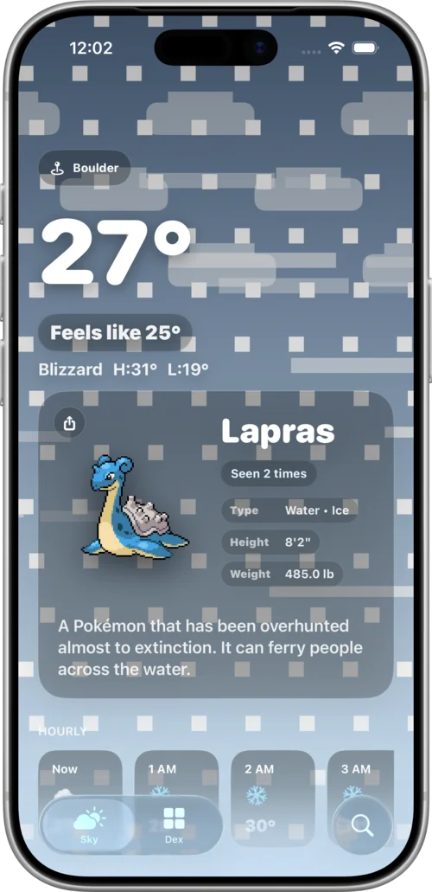
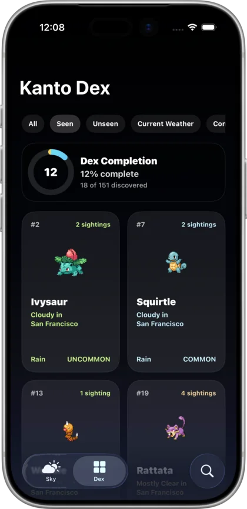
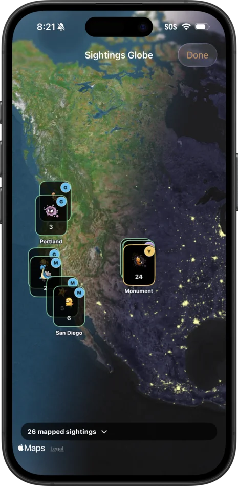
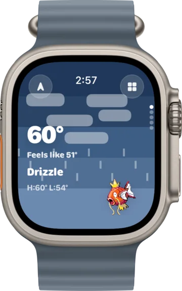

<section class="product-section" aria-labelledby="gallery-title">
  <h2 id="gallery-title">What did the weather bring?</h2>
  
Rain, snow, sun, and clouds bring different encounters. Check the hourly forecast, then open your Dex to see which Pokémon you’ve found.

  

    <figure><figcaption>Meet the Pokémon drawn to the weather around you.</figcaption></figure>
    <figure><figcaption>See your discoveries together and spot the gaps in your Dex.</figcaption></figure>
    <figure id="friends-title"><figcaption>Explore the sightings map and compare discoveries with friends.</figcaption></figure>
  

</section>
<section class="product-panel watch-panel" aria-labelledby="watch-title">
  
<h2 id="watch-title">Check the sky from your wrist.</h2>
Pair Skydex on iPhone with Apple Watch to see the current conditions, your latest encounter, and the forecast in a complication.

  
</section>
<section class="product-section" aria-labelledby="features-title">
  <h2 id="features-title">Skydex Pro</h2>
  
The free app includes the forecast, weather encounters, and up to six saved locations. Pro removes ads, unlocks alternate app icons, and lets you save unlimited locations.

</section>
<section class="product-section product-support" aria-labelledby="legal-title">
  <h2 id="legal-title">Support &amp; privacy</h2>
  
<a href="mailto:support@raktech.app">Email support</a><a href="/skydex/privacy/">Privacy policy</a><a href="/skydex/delete-account">Account deletion</a><a href="https://www.apple.com/legal/internet-services/itunes/dev/stdeula/">Apple Standard EULA</a>

  

Weather and Pokémon credits

Weather data comes from <a href="https://weatherkit.apple.com/legal-attribution.html">Apple Weather</a>, with fallback data from <a href="https://www.weatherapi.com/">WeatherAPI</a>.

Pokémon-related text, images, trademarks, logos, and other materials are the intellectual property of The Pokémon Company and its affiliates. Skydex is an independent application and is not produced, endorsed, supported, or affiliated with The Pokémon Company International. References to Pokémon content are used for informational and reference purposes only. Rights holders can contact <a href="mailto:support@raktech.app">support@raktech.app</a>.

</section>
