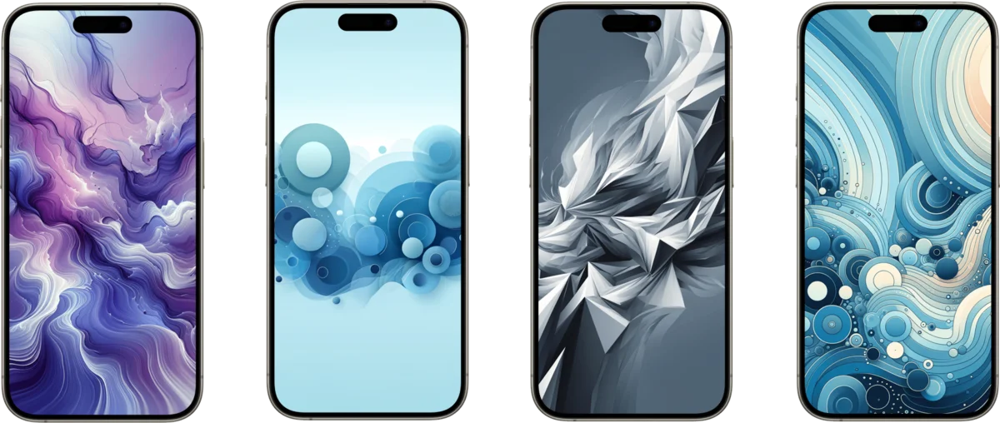
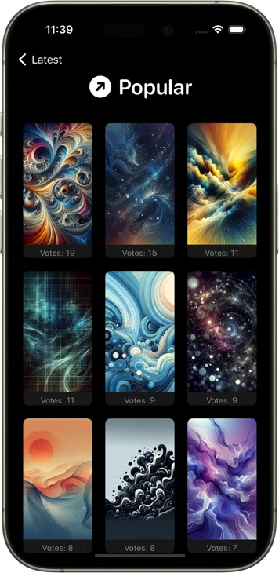

<section class="product-section product-split">
  
<h2>Made with Wall•Genie</h2>
Start with a subject and style, then see how the image generator interprets them. These wallpapers were made in the app.

  <figure></figure>
</section>
<section class="product-panel community-panel">
  
<h2>The community gallery</h2>
Browse shared designs and vote for favorites. The Popular view brings the community’s picks together, and a Shortcut can apply the latest free wallpaper to your phone.
<a href="https://www.youtube.com/watch?v=G8NIk2D4PKw">Watch the Wall•Genie walkthrough ↗</a>

  
</section>
<section class="product-section product-support" id="faq">
  <h2>Wall•Genie FAQ</h2>
  

Is a subscription required?

A subscription unlocks wallpaper generation and community downloads. Every seventh wallpaper in the community feed is a free download.

  

What engine is being used for image generation?

Wall•Genie uses OpenAI’s image generation service.

  

What is the Free Wallpaper Shortcut?

Add the Free Wallpaper Shortcut from the app to download and apply the latest free wallpaper. Run it yourself or schedule it in Apple Shortcuts.

  

What prompt is Wall•Genie using, and can it be customized?

Choose the creative options in the app. Wall•Genie builds the prompt from those selections.

  

What is the generated image resolution?

The image generator requests a portrait image at 1024 × 1536 pixels.

  

Does Wall•Genie allow for creating iPad and Desktop wallpapers?

The generator is designed for portrait phone wallpapers.

  

Why can't I take screenshots?

Screenshots in the app are available to subscribers.

  

Can you explain the pricing?

The Starter subscription is billed weekly and Pro is billed monthly. An active subscription covers generation and community downloads.

  

Can I change my subscription tier?

To change your subscription tier, open Info → Manage Subscription.

  

Does Wall•Genie support Family Sharing?

Family Sharing is not supported at this time.

</section>

<section class="product-section product-support" id="support">
  <h2>Support</h2>
Wall•Genie is part of the app archive. For questions about the iPhone app or an existing subscription, contact <a href="mailto:support@raktech.app">support@raktech.app</a>.

</section>

<section class="product-section product-support" id="terms" markdown="1">
<h2>Terms</h2>

By using Wall•Genie, you agree to the following terms, in addition to the [Apple Standard EULA](https://www.apple.com/legal/internet-services/itunes/dev/stdeula/):
- Images are created using Generative AI, and therefore results may vary.
- Wall•Genie and OpenAI (per their licensing guidelines) do not claim ownership of the images created.
- Images generated using Wall•Genie, by any user, can be used for both personal and commercial use without permission.
- Wall•Genie and its services are provided "as-is" and reserves the right to update, enhance, or change the service at any time.
- Abuse of Wall•Genie and its services, including API integrations, in-app screenshots, or other actions outside if the app's intended use are strictly prohibited and may result in a permanent ban.

</section>

<section class="product-section product-support" id="privacy" markdown="1">
<h2>Privacy</h2>

Privacy is a first-class citizen in Wall•Genie. Unlike other wallpaper apps, your usage is not tracked or tied to your identity, nor is a sign-in process required in order to use the app, keeping your identity completely anonymous. Certain statistics are collected anonymously in order to help improve the app; things like iPhone model, iOS version, wallpaper upvote count, wallpaper generation count, and wallpaper upload count. These stats are aggregated using the privacy-focused solution [TelemetryDeck](https://telemetrydeck.com).

</section>
