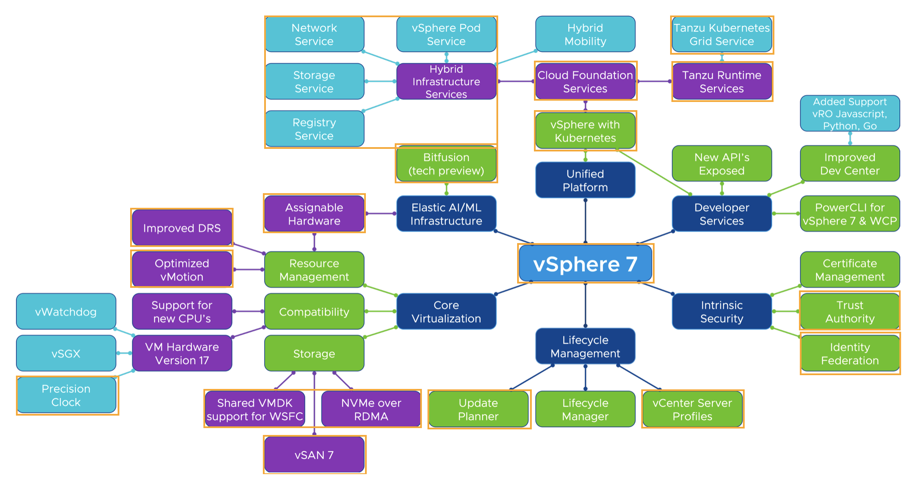

VMware announced vSphere 7 🚀 last month, and today they're making it a reality. vSphere 7 with Kubernetes is now Generally Available! 🥳 Here are some things you need to know!  

* TOC
{:toc}

## Where to start
There have been plenty (PLENTY) of posts covering what's new in vSphere 7, so we're not going to review that. Instead I think it would be helpful to consolidate a lot of the chatter and content out there into a single location. VMware has posted several of these types of blogs as well in the spirit of being able to relive the announcements and flow of content.

If you're looking to catch up, start by checking out this awesome compilation page: [http://vmw.re/vsphere7](http://vmw.re/vsphere7).  

Here's a quick recap of the top new features (per the datasheet):  

• vMotion Enhancements  
• Improved Distributed Resource Scheduling  
• Proactive High Availability  
• VM-Aware Storage  
• API and Policy Driven Storage Capabilities  
• Support for 4K Native Storage  
• vSphere Persistent Memory  
• vCenter Hybrid Linked Mode  
• Per-VM Enhanced vMotion Compatibility  
• Live Migration of Workloads  
• Protect VM and Data  
• VM-level Encryption  
• Support for TPM 2.0  
• Virtual TPM 2.0  
• FIPS 140-2 Compliance  
• Ensure System Uptime  
• Share Data Center Resources  
• Endpoint Security  
• Fault Tolerance  
• Instant Clone  
• Centralized Network Management  
• Load Balancing  
• Prioritize Resources to Virtual Machines  
• Rapid Deployment and Provisioning  
• Accelerated Graphics for Virtual Machines  
• Support for Suspend, Resume, vMotion, multi- vGPU per VM and Snapshot for NVIDIA
vGPUs  
• Automated Discovery of Application Assets, Intent, and Communication  
• Contextual Intelligence of Application State  
• Orchestrated or Automated Responses to Security Threats  
• Prioritized Vulnerability Reporting Across the Entire Data Center  

### vSphere 7 Mind Map
This interactive mind map for vSphere 7 allows you to drill into the key features and capabilities. [See it here.](https://vspherecentral.vmware.com/t/vsphere-7/vsphere-7-mind-map/)
  

### Getting to Know vSphere 7 Services
Borrowing this one from the *awesome compilation page* above, be sure to register for [this webcast series](https://www.vmug.com/education/webcasts/vsphere7-series). It'll be doing deep on fresh topics like managing modern apps on hybrid cloud, deploying Kubernetes clusters, lifecycle management, security, and starting your AI/ML journey with vSphere and Bitfusion.

## Get Learned
VMware has made it easy for you to get spun up on vSphere 7 from Day 1. Here's a list of classes and videos to get you started:

#### 📚 VMware Education Services
Officially covered in [this blog post](https://blogs.vmware.com/education/2020/03/17/7-new-courses-to-get-you-ready-for-vsphere-7/), you can now register for **What's New**, **Install, Configure, Manage (ICM)**, **Design**, and **Troubleshooting** courses.  

To learn more about these new courses, join us live on **April 7th** where experts will review the contents of each course and answer your questions. **Register now:** [April 7th @ 8:00am PDT](http://vmwarelearningzone.vmware.com/oltpublish/site/event.do?dispatch=show&id=29fd091a-650e-11ea-9f48-0cc47adeb5f8)  

#### 👨‍🔬 Hands On Lab
Hands On Labs (HOL) are guided lab exercises and environments delivered in your browser to get you hands on experience with our products. Check out [HOL-2013-01-ISM - vSphere 7 with Kubernetes](https://labs.hol.vmware.com/HOL/catalogs/lab/6877) for a "Lightning Lab" intro into vSphere + K8s.

#### 🎥 YouTube Playlist
VMware's official YouTube account has a [playlist of vSphere 7](https://www.youtube.com/watch?v=VtEs3X5pYlE&list=PLymLY4xJSThobr14re6QPul2xTfEFTR3d) specific videos with product overviews, feature deep dives, lightboard sessions, and more! Definitely a spot worth bookmarking.

## Resources
📄 [vSphere 7.0 Release Notes](https://docs.vmware.com/en/VMware-vSphere/7.0/rn/vsphere-esxi-vcenter-server-70-release-notes.html)  
⬇️ [VCSA 7.0 Download](https://my.vmware.com/web/vmware/details?downloadGroup=VC700&productId=974&rPId=44114)  
📄 [ESXi 7.0 Release Notes](https://docs.vmware.com/en/VMware-vSphere/7.0/rn/vsphere-esxi-vcenter-server-70-release-notes.html)  
⬇️ [ESXi 7.0 Download](https://my.vmware.com/web/vmware/details?downloadGroup=ESXI700&productId=974&rPId=44114)  
