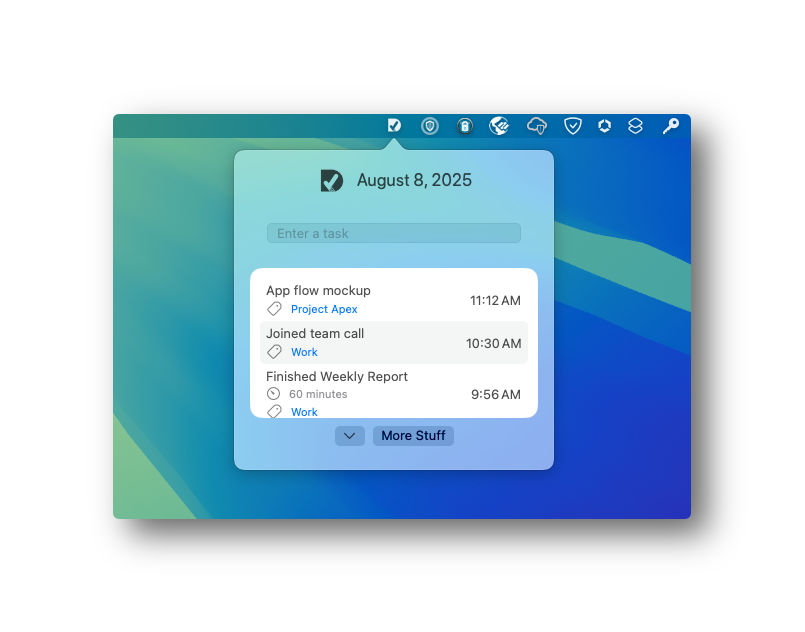
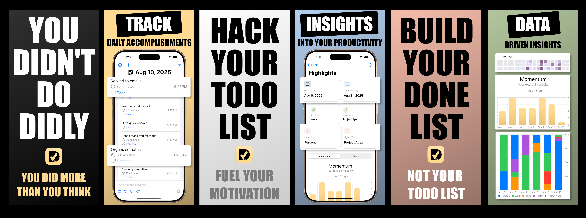

At the end of the day, it’s easy to focus on what didn’t get finished. That unchecked to-do list can make you feel like you’re falling behind, even if you got a lot done. That’s where a **“done list”** comes in. Instead of tracking what you *should* do, it keeps track of what you *actually did.*  

Turns out, there’s plenty of research showing this simple shift can improve focus, reduce stress, and even help you move forward in your career.

---

### Why Done Lists Work  

- **They calm the brain**  
  Checking something off gives your brain a sense of completion. That little “I did it” moment matters—studies show it reduces anxiety and helps you regain a sense of control ([Self.com](https://www.self.com/story/done-lists?utm_source=thatvirtualboy.com)).  

- **They make progress visible**  
  During stressful times, a traditional to-do list can feel like a never-ending reminder of what’s left. A done list flips the perspective—you can see proof of what you’ve already accomplished, even if it’s something small ([Wired](https://www.wired.com/story/productivity-got-done-list?utm_source=thatvirtualboy.com)).  

- **They build momentum**  
  Productivity experts point out that done lists create a feedback loop. Each recorded win—big or small—reinforces progress and makes it easier to tackle the next thing ([Inc.com](https://www.inc.com/jeff-haden/how-emotionally-intelligent-people-use-done-list-to-feel-more-productive-fulfilled-accomplished.html?utm_source=thatvirtualboy.com)).  

- **They help with reflection**  
  Looking back on what you’ve accomplished is motivating in itself. Chris Bailey, author of *The Productivity Project,* suggests reviewing your done list at the end of each week to spark ideas and focus for the next one ([ChrisBailey.com](https://chrisbailey.com/keep-a-weekly-accomplishments-list/?utm_source=thatvirtualboy.com)).  

### Why Not Just Stick With To-Dos?  

To-do lists aren’t the enemy—they’re useful for structure, prioritizing, and reducing mental clutter. The problem is when they’re the *only* system. They show you what’s left, not what’s working. Pairing a to-do list with a done list gives you the full picture: what needs attention *and* proof of progress.  

### How Didly Fits In  

The idea of a done list is simple, but keeping up with it consistently can be hard without the right tools. That’s where [Didly](https://apps.apple.com/us/app/done-not-a-to-do-app/id6503087781) comes in. It’s built around the value of helping you see progress clearly, stay motivated, and avoid burnout.  

Here’s how the platform supports that:  

- **Instant logging of wins** – Capture accomplishments in real time, big or small, so nothing slips through the cracks.  
- **Momentum tracking** – Didly builds a running record of your progress, giving you perspective that traditional to-do apps miss.  
- **Weekly recaps that work for you** – The app automatically charts together what you’ve finished, making reflection part of the workflow instead of another chore.  
- **Support for the small stuff** – Gentle prompts encourage logging everyday wins, because those add up to resilience and motivation.  

### Under the Hood: How Didly Is Built  

An Apple-exclusive, Didly is built with care for the platforms you use every day.  

- **Native to iOS and macOS** – Built with SwiftUI, Didly feels right at home on Apple devices.  
- **Syncs with Apple Reminders** – Optional integration keeps your existing ecosystem connected.  
- **Minimalist by design** – The interface is simple and uncluttered, so the focus stays on your progress.  
- **Big impact, low friction** – Every feature is designed to help you log, reflect, and move forward without slowing you down.  

### Why This Matters  

- **For your mind:** Done lists take the edge off stress and help you leave work feeling lighter.  
- **For your career:** Progress tracking shows you where your time really goes—and makes it easier to highlight wins during reviews or job interviews.  
- **For your motivation:** Seeing your track record makes starting the next task feel less daunting.  

---

### Final Thought  

Perhaps it's time to flip the script on your traditional to-do list and try focusing on your done list. Remember, you didn't do didly... you've done more than you think.    

👉 [Download Didly on the App Store](https://apps.apple.com/us/app/done-not-a-to-do-app/id6503087781)  
👉 [Learn more about Didly](https://thatvirtualboy.com/didly)  
